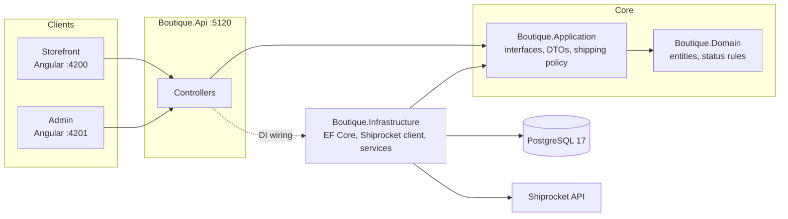
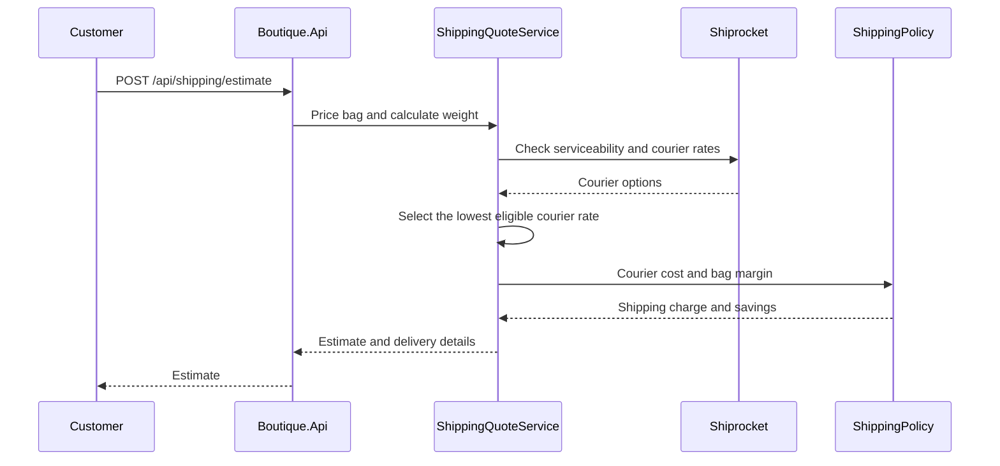

# Boutique e-commerce platform

A full-stack e-commerce project for a women's ethnic-wear boutique. The backend is an ASP.NET Core Web API with PostgreSQL; the customer storefront and staff admin are Angular applications.

The backend and frontend are maintained in separate repositories:

- Backend: this repository
- Frontend: [keyu04/boutique-web](https://github.com/keyu04/boutique-web)

The API is the integration boundary between them. Keeping the repositories separate lets each app use its own build, test, and release workflow.

## What it does

### Storefront

- Browse products, choose a size, and manage a shopping bag.
- Enter a pincode to estimate delivery and shipping.
- See free-delivery progress and shipping savings.
- Place a cash-on-delivery order.
- Track an order by order number and phone number.

### Admin

- View order queues and a 30-day summary.
- Search and filter orders, update their status, and add courier tracking details.
- Manage products, images, and stock.
- View reports with item revenue, cost of goods, shipping collected, courier costs, and net profit.
- Restrict cost and margin data to Admin users.

## Architecture



The backend follows Clean Architecture:

| Project | Responsibility | Depends on |
| --- | --- | --- |
| `Boutique.Domain` | Product, variant, order, user, and refresh-token entities; order-status rules | Nothing |
| `Boutique.Application` | Service contracts (including `IShippingQuoteService` and `ICourierRateProvider`), DTOs, and the pure shipping policy | Domain |
| `Boutique.Infrastructure` | EF Core and migrations, Shiprocket authentication/rates, quote and fallback services, image storage | Application, Domain |
| `Boutique.Api` | Controllers, authentication, rate limiting, OpenAPI, and dependency-injection wiring | All backend layers |
| `Boutique.Tests` | Unit tests and API-pipeline tests | Backend projects |

The Angular workspace in `boutique-web` contains the storefront, admin app, and shared API clients and models.

## Shipping estimates

The shipping flow uses live courier rates when configured and applies a server-side policy to calculate the customer charge.



Key design points:

- Courier credentials and pickup details stay on the server.
- The order endpoint recalculates shipping on the server and checks the customer's expected charge.
- The cheapest eligible courier is selected, including COD charges and COD support. Rates are cached for 15 minutes by pickup/delivery pincode, billable weight, and payment method.
- A definitive Shiprocket response that a pincode is not serviceable is rejected. When live rates are unavailable, the configured rule-based shipping service is used.
- Orders retain a snapshot of the courier cost for reporting.

The shipping policy is a pure function. Its floor is intended to ensure that the shipping charge does not reduce the order's margin below the configured minimum profit, assuming the courier cost is accurate.

## Security and correctness

| Concern | Design |
| --- | --- |
| Price tampering | Order totals are calculated by the server from database values. |
| Stock contention | Stock changes are handled in a database transaction with PostgreSQL concurrency checks. |
| Slow courier API | Courier quoting is performed before the order's database transaction. |
| Cost data visibility | Cost and margin data are restricted by role on the server. |
| Authentication | ASP.NET Core Identity and JWT access tokens are used with refresh-token cookies. |
| Order tracking abuse | Public tracking and shipping-estimate endpoints are rate-limited. |
| Secrets | Keep local credentials in user-secrets or an untracked local environment file; never commit them. |

## Tech stack

- **Backend:** ASP.NET Core 10, EF Core 10, Npgsql, ASP.NET Core Identity, JWT bearer authentication
- **Database:** PostgreSQL 17
- **Frontend:** Angular 22, npm workspace, shared library
- **Courier rates:** Shiprocket API (optional, server-side)
- **Tests:** .NET tests with `dotnet test`

## Run locally

### Prerequisites

.NET 10 SDK, Node.js compatible with Angular 22, npm, and Docker. A Shiprocket API user is optional; without live courier credentials, the configured rule-based shipping service can be used.

### 1. Start PostgreSQL

From this repository root, ensure the local, untracked `.env` file defines `POSTGRES_USER`, `POSTGRES_PASSWORD`, and `POSTGRES_DB`, then start the database:

```powershell
docker compose up -d postgres
```

The compose file maps PostgreSQL to host port `5433`.

### 2. Configure API user-secrets

From `src/Boutique.Api`, set a connection string that matches the local database and the JWT settings:

```powershell
dotnet user-secrets set "ConnectionStrings:Default" "Host=localhost;Port=5433;Database=<database>;Username=<user>;Password=<password>"
dotnet user-secrets set "Jwt:Key" "<long random signing key>"
dotnet user-secrets set "Jwt:Issuer" "<issuer>"
dotnet user-secrets set "Jwt:Audience" "<audience>"
dotnet user-secrets set "Seed:StaffPassword" "<staff password>"
```

For browser requests from the local Angular apps, configure the allowed origins:

```powershell
dotnet user-secrets set "Cors:Origins:0" "http://localhost:4200"
dotnet user-secrets set "Cors:Origins:1" "http://localhost:4201"
```

For live courier rates, also set:

```powershell
dotnet user-secrets set "Shiprocket:Email" "<API-user email>"
dotnet user-secrets set "Shiprocket:Password" "<API-user password>"
dotnet user-secrets set "Shiprocket:PickupPincode" "<pickup pincode>"
```

The development seeder currently creates an Admin account using a development-only password in code. Do not use that account setup outside local development; replace it with a securely configured password before any shared or deployed use.

### 3. Apply migrations and start the API

From the backend repository root:

```powershell
dotnet ef database update --project src/Boutique.Infrastructure --startup-project src/Boutique.Api
dotnet run --project src/Boutique.Api --launch-profile http
```

The API listens at `http://localhost:5120`.

### 4. Start the Angular apps

In a separate terminal, from the frontend repository:

```powershell
cd B:\MyTasks\Dotnet\boutique-web
npm install
npm run start:storefront
```

The storefront runs at `http://localhost:4200`. To run the admin app, use another terminal in the frontend repository:

```powershell
npm run start:admin
```

The admin app runs at `http://localhost:4201`. Both apps currently use `http://localhost:5120/api` as their API base URL.

### Tests

From the backend repository root:

```powershell
dotnet test
```

## Main API endpoints

| Endpoint | Access | Purpose |
| --- | --- | --- |
| `GET /api/products` | Public | Product catalogue |
| `POST /api/shipping/estimate` | Public, rate-limited | Estimate shipping and delivery |
| `POST /api/orders` | Public | Place an order with server-side pricing |
| `POST /api/orders/track` | Public, rate-limited | Track an order by order number and phone |
| `POST /api/auth/login`, `/refresh`, `/logout` | Public / refresh cookie | Admin and staff authentication |
| `GET /api/admin/orders`, `PATCH .../status`, `PATCH .../tracking` | Admin, Staff | Manage orders |
| `GET/POST/PUT /api/admin/products` | Admin and Staff reads; Admin writes | Manage products |
| `GET /api/admin/reports/summary` | Admin | Revenue, cost, shipping, and profit summary |
| `GET /api/admin/shipping/quotes` | Admin | Inspect courier quotes |

## Roadmap

- Add online payments and prepaid checkout.
- Create courier shipments and handle tracking updates and webhooks.
- Include return-to-origin costs in the COD profit model.
- Add continuous integration for builds, tests, and linting.
